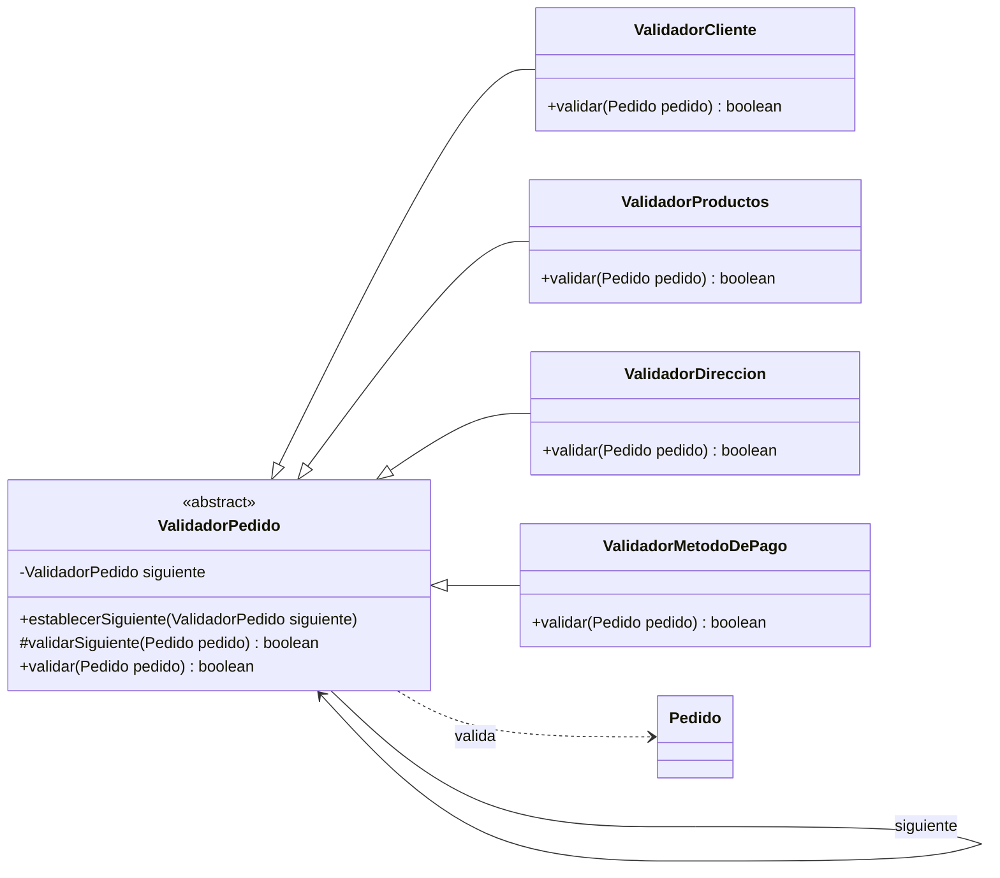

# Chain of Responsibility

Chain of Responsibility es un patrón de diseño de comportamiento que permite enviar una solicitud a través de una cadena de objetos llamados handlers.

Cada handler tiene una responsabilidad concreta y decide si procesa la solicitud, la delega al siguiente elemento o detiene la cadena.

---

## Problema

En un e-commerce, antes de continuar con el procesamiento de un pedido pueden ser necesarias distintas validaciones:

- ¿Existe un cliente?
- ¿El pedido tiene productos?
- ¿Tiene una dirección de envío?
- ¿Existe un método de pago?

Cuando existen pocas reglas, estas validaciones pueden concentrarse en un mismo componente.

Sin embargo, a medida que aparecen nuevas reglas, este componente puede acumular demasiadas responsabilidades.

Además, el código encargado del proceso debe conocer qué validaciones ejecutar y en qué orden.

---

## Solución

Chain of Responsibility propone separar cada responsabilidad en un handler independiente y conectarlos formando una cadena.

En este proyecto:

```text
ValidadorCliente
        ↓
ValidadorProductos
        ↓
ValidadorDireccion
        ↓
ValidadorMetodoDePago
```

Cada handler realiza una validación.

Si es correcta:

```java
return validarSiguiente(pedido);
```

Si falla:

```java
return false;
```

La cadena se interrumpe y los handlers siguientes no se ejecutan.

---

## Antes y después de aplicar Chain of Responsibility

### Antes

Las validaciones podrían estar concentradas en un único método:

```java
public boolean validarPedido(Pedido pedido) {

    if (pedido.getCliente() == null) {
        return false;
    }

    if (pedido.getProductos().isEmpty()) {
        return false;
    }

    if (pedido.getDireccionEnvio() == null ||
            pedido.getDireccionEnvio().isBlank()) {
        return false;
    }

    if (pedido.getMetodoDePago() == null) {
        return false;
    }

    return true;
}
```

Agregar, eliminar o reorganizar reglas implica modificar el mismo componente.

### Después

Cada validación tiene su propia responsabilidad:

```text
Pedido
  │
  ▼
ValidadorCliente
  │
  ▼
ValidadorProductos
  │
  ▼
ValidadorDireccion
  │
  ▼
ValidadorMetodoDePago
```

El código cliente solamente inicia el procesamiento desde el primer handler:

```java
boolean esPedidoValido = validadorCliente.validar(pedido);
```

---

## Ejemplo en este proyecto

El handler base es `ValidadorPedido`:

```java
public abstract class ValidadorPedido {

    private ValidadorPedido siguiente;

    public void establecerSiguiente(ValidadorPedido siguiente) {
        this.siguiente = siguiente;
    }

    protected boolean validarSiguiente(Pedido pedido) {
        if (siguiente == null) {
            return true;
        }

        return siguiente.validar(pedido);
    }

    public abstract boolean validar(Pedido pedido);
}
```

Cada handler concreto implementa una validación específica:

```text
ValidadorCliente → verifica que exista un cliente

ValidadorProductos → verifica que existan productos

ValidadorDireccion → verifica que exista una dirección válida

ValidadorMetodoDePago → verifica que exista un método de pago
```

Por ejemplo, `ValidadorDireccion`:

```java
@Override
public boolean validar(Pedido pedido) {

    System.out.println("Validando direccion...");

    if (pedido.getDireccionEnvio() == null || pedido.getDireccionEnvio().isBlank()) {

        System.out.println("ERROR: El pedido no tiene una direccion de envio");

        return false;
    }

    System.out.println("Direccion valida");
    return validarSiguiente(pedido);
}
```

La cadena se configura de esta manera:

```java
validadorCliente.establecerSiguiente(validadorProductos);
validadorProductos.establecerSiguiente(validadorDireccion);
validadorDireccion.establecerSiguiente(validadorMetodoPago);
```

Una vez configurada, puede reutilizarse para validar distintos pedidos.

---

## Participantes del patrón

### Handler

Define el comportamiento común y mantiene la referencia al siguiente elemento.

En este proyecto:

```text
ValidadorPedido
```

### Concrete Handlers

Implementan las distintas responsabilidades:

```text
ValidadorCliente
ValidadorProductos
ValidadorDireccion
ValidadorMetodoDePago
```

### Request

Es el objeto que recorre la cadena.

En este proyecto:

```text
Pedido
```

### Client

Configura la cadena e inicia el procesamiento.

En este proyecto:

```text
ChainOfResponsibilityDemo
```

En este contexto, **Client** hace referencia al código que configura el patrón y no debe confundirse con la clase `Cliente` del dominio del e-commerce.

---

## ¿Cómo manejar una validación fallida?

En esta implementación se utiliza `boolean` para mantener el ejemplo simple:

```java
boolean esPedidoValido = validadorCliente.validar(pedido);
```

De esta forma:

```text
true  → el pedido superó toda la cadena
false → alguna validación falló
```

Sin embargo, existen otras alternativas.

### Excepción

Un handler podría detener el procesamiento lanzando una excepción:

```java
if (pedido.getDireccionEnvio() == null) {
    throw new IllegalStateException("El pedido no tiene una direccion de envio");
}
```

Puede ser útil cuando el fallo representa una situación excepcional.

### Objeto de resultado

También podría utilizarse un objeto con más información:

```text
ResultadoValidacion
-------------------
valido: false
mensaje: "El pedido no tiene una direccion de envio"
```

Esta alternativa permite comunicar el motivo del fallo sin depender de mensajes por consola.

En este ejemplo se utiliza `boolean` para mantener el foco en el funcionamiento de Chain of Responsibility.

---

## Relación con Builder

El proyecto ya utiliza `PedidoBuilder`, que valida algunos datos obligatorios antes de construir un pedido:

```text
Cliente          → obligatorio
Productos        → obligatorio
Método de pago   → obligatorio
Dirección        → opcional
```

Por eso, algunas validaciones utilizadas en esta cadena también están presentes en el Builder.

Se mantienen en este ejemplo con fines didácticos para mostrar claramente cómo distintos handlers procesan una misma solicitud.

Conceptualmente, las responsabilidades son diferentes:

```text
Builder
   ↓
¿Puedo construir este Pedido?


Chain of Responsibility
   ↓
¿Puede este Pedido continuar con este proceso?
```

En una aplicación real conviene evitar duplicar las mismas reglas.

Una cadena de procesamiento podría utilizarse, por ejemplo, para:

```text
ValidarStock
      ↓
ValidarCoberturaEnvio
      ↓
ValidarLimiteCompra
      ↓
ValidarFraude
```

Estas reglas corresponden al procesamiento del pedido y no necesariamente a su construcción.

---

## Diferencia entre Chain of Responsibility y Command

Ambos son patrones de comportamiento, pero resuelven problemas diferentes.

### Command

Encapsula una acción como un objeto.

En este proyecto:

```text
PagarPedidoCommand
EnviarPedidoCommand
CancelarPedidoCommand
```

Responde a:

> ¿Qué acción quiero ejecutar?

### Chain of Responsibility

Permite que una solicitud pase por diferentes handlers:

```text
ValidadorCliente
        ↓
ValidadorProductos
        ↓
ValidadorDireccion
        ↓
ValidadorMetodoDePago
```

Responde a:

> ¿Por qué handlers debe pasar esta solicitud?

Ambos patrones pueden colaborar. Por ejemplo, un pedido podría pasar por una cadena de validaciones antes de ejecutar un `PagarPedidoCommand`.

---

## Diagrama UML



En este diagrama:

- `ValidadorPedido` representa el **Handler**.
- Los distintos validadores representan los **Concrete Handlers**.
- `Pedido` representa la solicitud que recorre la cadena.
- Cada handler puede mantener una referencia al siguiente elemento.
- `ChainOfResponsibilityDemo`, aunque no se muestra para simplificar el diagrama, cumple el rol de **Client**.

---

## Flujo del ejemplo

### Pedido válido

```text
Pedido 1
   ↓
Cliente          ✓
   ↓
Productos        ✓
   ↓
Dirección        ✓
   ↓
Método de pago   ✓
   ↓
 true
```

Salida:

```text
Validando pedido 1

Validando cliente...
Cliente valido
Validando productos...
Productos validos
Validando direccion...
Direccion valida
Validando metodo de pago...
Metodo de pago valido

Pedido valido: true
```

### Pedido sin dirección

```text
Pedido 2
   ↓
Cliente          ✓
   ↓
Productos        ✓
   ↓
Dirección        ✗
   ↓
  STOP
```

Salida:

```text
Validando pedido 2

Validando cliente...
Cliente valido
Validando productos...
Productos validos
Validando direccion...
ERROR: El pedido no tiene una direccion de envio

Pedido valido: false
```

Como `ValidadorDireccion` devuelve `false`, `ValidadorMetodoDePago` no llega a ejecutarse.

---

## Estructura del ejemplo

```text
src/main/java/com/bren/patrones/comportamiento/
└── chainofresponsibility/
    ├── ValidadorPedido.java
    ├── ValidadorCliente.java
    ├── ValidadorProductos.java
    ├── ValidadorDireccion.java
    ├── ValidadorMetodoDePago.java
    └── ChainOfResponsibilityDemo.java
```

La documentación se encuentra en:

```text
patrones-comportamiento/
└── chainofresponsibility/
    └── README.md
```

---

## Código fuente
El código completo del ejemplo se encuentra en:

[Ver código de Chain of Responsibility](../../src/main/java/com/bren/patrones/comportamiento/chainofresponsibility)

---

## Cuándo usar Chain of Responsibility

Resulta útil cuando:

- Una solicitud debe pasar por varios pasos o controles.
- Cada etapa tiene una responsabilidad independiente.
- El orden del procesamiento puede cambiar.
- Se quieren agregar o quitar pasos sin modificar el código que inicia el proceso.
- Un handler puede decidir detener el procesamiento.
- Se quieren reutilizar handlers para construir diferentes cadenas.

Ejemplos habituales incluyen validaciones, middlewares, filtros, autorización y flujos de aprobación.

---

## Cuándo no usarlo

Puede no ser conveniente cuando:

- Existe una única operación simple.
- Los pasos son pocos, fijos y no se espera que cambien.
- No existe necesidad de modificar o detener el flujo.
- Separar cada paso en un handler agrega más complejidad que beneficio.

No toda secuencia de validaciones necesita convertirse en una cadena.

---

## Resumen

Chain of Responsibility distribuye el procesamiento de una solicitud entre una cadena de handlers.

Cada handler tiene una responsabilidad específica y decide si la solicitud continúa hacia el siguiente elemento o si el procesamiento se detiene.

En este proyecto, el código cliente inicia la validación desde `ValidadorCliente` y no necesita conocer ni ejecutar manualmente cada paso de la cadena.