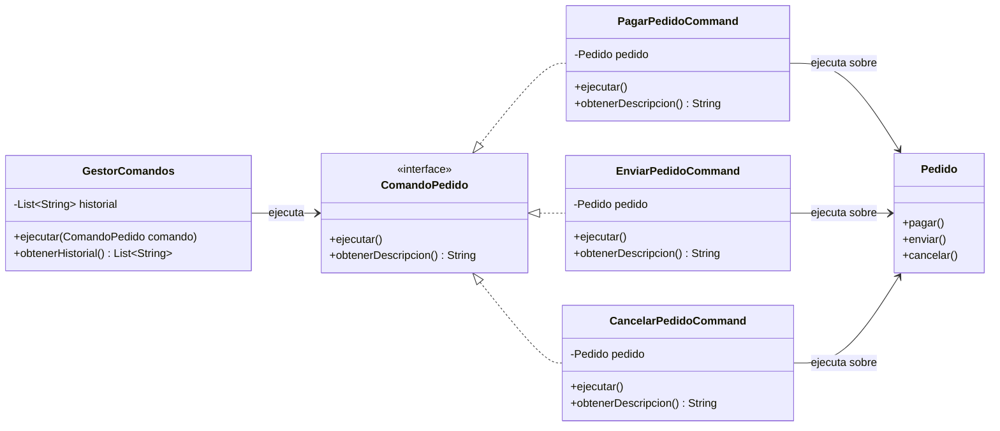

# Command

Command es un patrón de diseño de comportamiento que convierte una solicitud o acción en un objeto independiente.

Esto permite desacoplar el objeto que solicita una operación del objeto que realmente sabe cómo ejecutarla y, además, permite tratar las acciones como objetos que pueden almacenarse, registrarse, ponerse en cola o ejecutarse posteriormente.

---

## Problema

En una implementación directa, el código que necesita realizar una acción sobre un pedido llama al método correspondiente:

```java
pedido.pagar();
pedido.enviar();
pedido.cancelar();
```

Esto funciona, pero quien solicita la operación necesita conocer directamente al objeto `Pedido` y qué método debe ejecutar.

Además, la acción existe únicamente como una llamada a un método. No tenemos un objeto que represente, por ejemplo:

- "Pagar el pedido 1".
- "Enviar el pedido 1".
- "Cancelar el pedido 2".

Esto dificulta tratar las solicitudes como elementos independientes para almacenarlas, registrarlas, ponerlas en una cola o ejecutarlas posteriormente.

---

## Solución

Command propone encapsular cada solicitud dentro de un objeto.

En este proyecto se define una interfaz común:

```java
public interface ComandoPedido {
    void ejecutar();

    String obtenerDescripcion();
}
```

Luego, cada operación se representa mediante un comando concreto:

```text
PagarPedidoCommand
EnviarPedidoCommand
CancelarPedidoCommand
```

Todos implementan `ComandoPedido`, por lo que pueden ser tratados de la misma manera.

Por ejemplo:

```java
ComandoPedido pagarPedido = new PagarPedidoCommand(pedido);

gestorComandos.ejecutar(pagarPedido);
```

`GestorComandos` no necesita conocer qué operación específica representa el comando.

Simplemente ejecuta:

```java
comando.ejecutar();
```

---

## Antes y después de aplicar Command

### Antes

El código ejecuta directamente las operaciones sobre el pedido:

```java
pedido.pagar();
pedido.enviar();
pedido.cancelar();
```

Quien solicita la acción conoce directamente qué método debe ejecutar.

```text
Código cliente
     |
     | pagar()
     | enviar()
     | cancelar()
     v
   Pedido
```

### Después

Cada solicitud se convierte en un objeto:

```java
ComandoPedido pagarPedido = new PagarPedidoCommand(pedido);

ComandoPedido enviarPedido = new EnviarPedidoCommand(pedido);
```

Y un mismo componente puede ejecutar cualquier comando:

```java
gestorComandos.ejecutar(pagarPedido);
gestorComandos.ejecutar(enviarPedido);
```

```text
Código cliente
      |
      v
GestorComandos
      |
      v
ComandoPedido
      |
      v
    Pedido
```

Ahora las solicitudes pueden manipularse como objetos independientes.

---

## Ejemplo en este proyecto

El e-commerce permite realizar distintas acciones sobre los pedidos:

- Pagar un pedido.
- Enviar un pedido.
- Cancelar un pedido.

Cada acción se representa mediante un Command:

```text
PagarPedidoCommand
        |
        v
   pedido.pagar()


EnviarPedidoCommand
        |
        v
   pedido.enviar()


CancelarPedidoCommand
        |
        v
   pedido.cancelar()
```

Los comandos no contienen las reglas de negocio relacionadas con los estados del pedido.

Por ejemplo:

```java
@Override
public void ejecutar() {
    pedido.pagar();
}
```

El comando solamente encapsula la solicitud.

`Pedido` continúa siendo responsable de delegar la operación al estado correspondiente mediante el patrón State.

---

## ¿Cómo funciona Command?

El patrón está formado por distintos participantes.

### Command

Define la interfaz común para ejecutar las solicitudes.

En este proyecto:

```java
public interface ComandoPedido {

    void ejecutar();

    String obtenerDescripcion();
}
```

### Concrete Command

Representa una solicitud concreta.

En este proyecto:

```text
PagarPedidoCommand
EnviarPedidoCommand
CancelarPedidoCommand
```

Cada comando mantiene una referencia al `Pedido` sobre el cual debe realizarse la operación.

Por ejemplo:

```java
public class PagarPedidoCommand implements ComandoPedido {

    private final Pedido pedido;

    @Override
    public void ejecutar() {
        pedido.pagar();
    }
}
```

### Receiver

Es el objeto que sabe cómo realizar realmente la operación.

En este proyecto el Receiver es:

```text
Pedido
```

Los comandos delegan en él:

```java
pedido.pagar();
pedido.enviar();
pedido.cancelar();
```

### Invoker

Es el objeto encargado de invocar la ejecución de un comando sin necesitar conocer cómo se realiza internamente la operación.

En este proyecto:

```text
GestorComandos
```

Su implementación no depende de un comando concreto:

```java
public void ejecutar(ComandoPedido comando) {
    comando.ejecutar();
    historial.add(comando.obtenerDescripcion());
}
```

Por lo tanto, puede trabajar con cualquier implementación de `ComandoPedido`.

### Client

Es quien crea y configura los comandos asociándolos con el Receiver correspondiente.

En el ejemplo, este rol lo cumple `CommandDemo`.

---

## Historial de comandos

Una de las ventajas de representar las solicitudes mediante objetos es que pueden almacenarse o registrarse.

`GestorComandos` mantiene un historial:

```java
private final List<String> historial = new ArrayList<>();
```

Cada vez que ejecuta un comando:

```java
comando.ejecutar();
historial.add(comando.obtenerDescripcion());
```

El resultado del ejemplo es:

```text
Historial de comandos:
- Pagar pedido 1
- Enviar pedido 1
- Cancelar pedido 2
```

De esta manera, el mismo mecanismo que ejecuta distintos comandos también puede registrar las acciones realizadas sin necesitar conocer la implementación concreta de cada una.

El historial se expone mediante una lista no modificable:

```java
public List<String> obtenerHistorial() {
    return Collections.unmodifiableList(historial);
}
```

Así, el historial puede consultarse desde afuera sin permitir que otros objetos modifiquen directamente la lista interna de `GestorComandos`.

---

## Colaboración con otros patrones

Command reutiliza el comportamiento que ya existe en el proyecto.

En particular, trabaja junto con **State**.

Por ejemplo:

```text
PagarPedidoCommand
        |
        | ejecutar()
        v
     Pedido
        |
        | pagar()
        v
      State
```

Command representa **qué solicitud debe ejecutarse**, mientras que State determina **cómo debe responder el pedido según su estado actual**.

Por ejemplo, `PagarPedidoCommand` no necesita conocer si el pedido está en estado `CREADO`, `PAGADO` o `CANCELADO`.

Simplemente ejecuta:

```java
pedido.pagar();
```

Las reglas relacionadas con el estado continúan encapsuladas en State.

Esto permite que ambos patrones tengan responsabilidades diferentes y puedan colaborar sin duplicar lógica.

---

## Diferencia entre Command y Strategy

Aunque ambos patrones encapsulan comportamiento detrás de una interfaz, resuelven problemas diferentes.

### Strategy

Strategy encapsula distintas formas de realizar una misma tarea.

En este proyecto:

```text
EstrategiaPago
├── PagoConMercadoPago
├── PagoConTarjeta
└── PagoConTransferencia
```

Todas representan diferentes estrategias para realizar un pago.

La pregunta que responde Strategy es:

> ¿Cómo quiero realizar esta operación?

### Command

Command encapsula una solicitud o acción que debe ejecutarse.

En este proyecto:

```text
ComandoPedido
├── PagarPedidoCommand
├── EnviarPedidoCommand
└── CancelarPedidoCommand
```

La pregunta que responde Command es:

> ¿Qué acción quiero ejecutar?

Por lo tanto:

```text
Strategy → distintas formas de hacer algo.

Command  → distintas acciones que pueden ejecutarse.
```

Además, al representar las solicitudes mediante objetos, Command permite almacenarlas, registrarlas, encolarlas o ejecutarlas posteriormente.

---

## Diagrama UML



En este diagrama:

- `ComandoPedido` representa **Command**.
- `PagarPedidoCommand`, `EnviarPedidoCommand` y `CancelarPedidoCommand` representan **Concrete Commands**.
- `Pedido` representa el **Receiver**.
- `GestorComandos` representa el **Invoker**.
- `CommandDemo`, aunque no se muestra para simplificar el diagrama, cumple el rol de **Client** en el ejemplo.

---

## Código principal

El núcleo del patrón está en la interfaz:

```java
public interface ComandoPedido {

    void ejecutar();

    String obtenerDescripcion();
}
```

Cada comando encapsula una solicitud y conoce el objeto sobre el cual debe ejecutarla:

```java
public class CancelarPedidoCommand implements ComandoPedido {

    private final Pedido pedido;

    public CancelarPedidoCommand(Pedido pedido) {
        if (pedido == null) {
            throw new IllegalArgumentException("El pedido no puede ser nulo");
        }

        this.pedido = pedido;
    }

    @Override
    public void ejecutar() {
        pedido.cancelar();
    }

    @Override
    public String obtenerDescripcion() {
        return "Cancelar pedido " + pedido.getId();
    }
}
```

El Invoker puede ejecutar cualquier comando sin depender de su implementación concreta:

```java
public void ejecutar(ComandoPedido comando) {

    if (comando == null) {
        throw new IllegalArgumentException("El comando no puede ser nulo");
    }

    comando.ejecutar();
    historial.add(comando.obtenerDescripcion());
}
```

---

## Flujo del ejemplo

Para el primer pedido:

```text
Pedido 1
CREADO
   |
   | PagarPedidoCommand
   v
PAGADO
   |
   | EnviarPedidoCommand
   v
ENVIADO
```

Para el segundo pedido:

```text
Pedido 2
CREADO
   |
   | CancelarPedidoCommand
   v
CANCELADO
```

Mientras tanto, `GestorComandos` registra las solicitudes ejecutadas:

```text
Historial de comandos
        |
        ├── Pagar pedido 1
        ├── Enviar pedido 1
        └── Cancelar pedido 2
```

---

## Estructura del ejemplo

```text
src/main/java/com/bren/patrones/comportamiento/
└── command/
    ├── ComandoPedido.java
    ├── PagarPedidoCommand.java
    ├── EnviarPedidoCommand.java
    ├── CancelarPedidoCommand.java
    ├── GestorComandos.java
    └── CommandDemo.java
```

La documentación del patrón se encuentra en:

```text
patrones-comportamiento/
└── command/
    └── README.md
```

---

## Código fuente
El código completo del ejemplo se encuentra en:

[Ver código de Command](../../src/main/java/com/bren/patrones/comportamiento/command)

---

## Cuándo usar Command

Command resulta útil cuando:

- Se quiere desacoplar quién solicita una operación de quién la ejecuta.
- Las acciones necesitan representarse como objetos independientes.
- Se necesita almacenar o registrar solicitudes.
- Se quieren colocar operaciones en una cola.
- Las operaciones deben poder programarse o ejecutarse posteriormente.
- Se necesita mantener un historial de acciones.
- Se quiere implementar funcionalidad de deshacer o rehacer y el diseño de los comandos contempla cómo revertir las operaciones.

---

## Cuándo no usarlo

No siempre es necesario convertir cada operación en un Command.

Puede no ser conveniente cuando:

- Las operaciones son simples y se ejecutan directamente sin necesidad de desacoplamiento.
- No se necesita almacenar, registrar, encolar o retrasar solicitudes.
- Crear una clase por cada acción agrega complejidad sin aportar una ventaja concreta.
- El sistema tiene pocas operaciones y no se espera que el mecanismo de ejecución evolucione.

Por ejemplo, si solamente necesitamos:

```java
pedido.pagar();
```

y nunca vamos a tratar esa solicitud como un objeto independiente, crear un `PagarPedidoCommand` podría agregar una abstracción innecesaria.

---

## Resumen

Command convierte una solicitud en un objeto.

En este e-commerce:

```text
ComandoPedido
        |
        ├── PagarPedidoCommand
        ├── EnviarPedidoCommand
        └── CancelarPedidoCommand
```

Cada comando encapsula una acción y delega su ejecución al `Pedido`.

`GestorComandos` puede ejecutar todos los comandos mediante una misma interfaz y mantener un historial de las acciones realizadas.

De esta forma:

```text
Solicitud
    ↓
Command
    ↓
Invoker
    ↓
Receiver
```

La principal ventaja es que las solicitudes dejan de ser únicamente llamadas directas a métodos y pasan a ser objetos independientes que pueden ejecutarse, almacenarse, registrarse, ponerse en cola o utilizarse como base para funcionalidades más avanzadas.