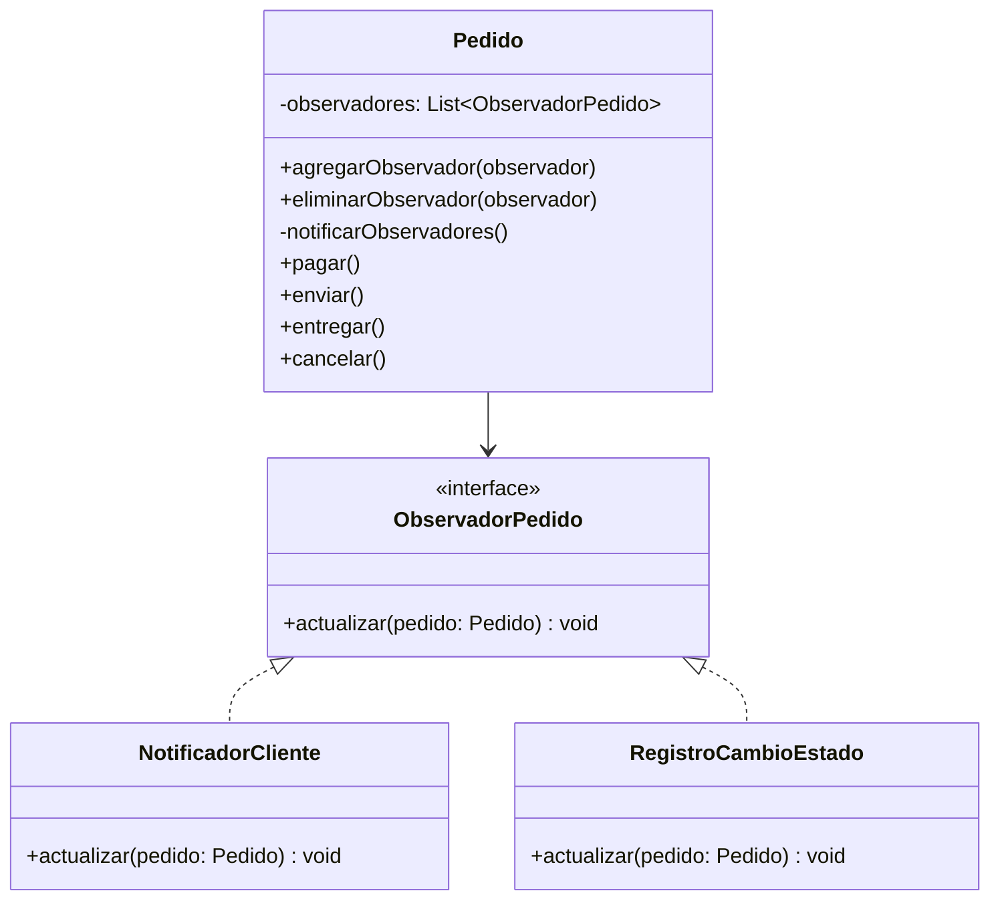

# Observer

## Problema

En un e-commerce es habitual que distintas partes del sistema necesiten reaccionar cuando cambia el estado de un pedido.

Por ejemplo, cuando un pedido pasa a **PAGADO**, podría ser necesario:

- Notificar al cliente.
- Registrar el cambio de estado.
- Actualizar el stock.
- Generar una factura.
- Informar al sistema de envíos.

Sin aplicar el patrón Observer, el propio `Pedido` debería conocer todas esas acciones y ejecutarlas directamente.

```java
public void pagar() {
    estadoPedido = EstadoPedido.PAGADO;

    notificarCliente();
    registrarCambioEstado();
    actualizarStock();
    generarFactura();
}
```

Cada vez que se agrega una nueva acción, es necesario modificar la clase `Pedido`, aumentando su acoplamiento y haciendo que resulte más difícil de mantener.

---

## Solución

El patrón **Observer** permite establecer una relación uno a muchos entre un objeto y los componentes interesados en conocer sus cambios de estado.

Para lograrlo, el objeto observado mantiene una lista de observadores registrados.

Cuando ocurre un cambio importante, simplemente notifica a todos ellos sin conocer cómo reaccionará cada uno.

En este ejemplo, todos los observadores implementan la interfaz `ObservadorPedido`.

```java
public interface ObservadorPedido {
    void actualizar(Pedido pedido);
}
```

Cada implementación define una acción diferente:

- `NotificadorCliente`
- `RegistroCambioEstado`

La clase `Pedido` únicamente notifica el cambio de estado, mientras que cada observador decide qué hacer con esa información.

De esta manera, es posible incorporar nuevos comportamientos sin modificar la clase `Pedido`.

---

## Antes y después de aplicar Observer

### Sin Observer

Sin aplicar el patrón, `Pedido` debería ejecutar directamente todas las acciones relacionadas con el cambio de estado.

```java
public void pagar() {
    estadoPedido = EstadoPedido.PAGADO;

    notificarCliente();
    registrarCambioEstado();
    actualizarStock();
}
```

Cada nueva funcionalidad obliga a modificar nuevamente la clase.

### Con Observer

Con Observer, `Pedido` solamente cambia su estado y notifica a los observadores registrados.

```java
pedido.agregarObservador(new NotificadorCliente());
pedido.agregarObservador(new RegistroCambioEstado());

pedido.pagar();
```

Cada observador recibe el evento y ejecuta únicamente la responsabilidad que le corresponde.

---

## Ejemplo en este proyecto

En este proyecto, el `Pedido` se construye previamente mediante el patrón **Builder**.

Luego se registran distintos observadores interesados en conocer los cambios de estado del pedido.

```java
ObservadorPedido notificadorCliente = new NotificadorCliente();

ObservadorPedido registroCambioEstado = new RegistroCambioEstado();

pedido.agregarObservador(notificadorCliente);
pedido.agregarObservador(registroCambioEstado);
```

Cuando el pedido cambia de estado, `Pedido` recorre todos los observadores registrados.

```java
private void notificarObservadores() {
    observadores.forEach(observador -> observador.actualizar(this));
}
```

Por ejemplo, al ejecutar:

```java
pedido.pagar();
```

se obtiene:

```text
Notificando a Brenda: el pedido 1 ahora se encuentra PAGADO
Registrando cambio de estado del pedido 1: PAGADO
```

Si posteriormente se ejecuta:

```java
pedido.enviar();
pedido.entregar();
```

los mismos observadores volverán a recibir la notificación correspondiente.

---

## ¿Por qué mantener una lista de observadores?

`Pedido` mantiene internamente una colección de observadores registrados.

```java
private final List<ObservadorPedido> observadores = new ArrayList<>();
```

Los observadores pueden agregarse o eliminarse dinámicamente.

```java
pedido.agregarObservador(new NotificadorCliente());

pedido.eliminarObservador(observador);
```

Cuando cambia el estado del pedido, `Pedido` solamente recorre esa colección y notifica el cambio.

```java
private void notificarObservadores() {
    observadores.forEach(observador -> observador.actualizar(this));
}
```

De esta manera, el objeto observado no necesita conocer qué hace cada observador.

---

## Flujo del ejemplo

El flujo completo queda así:

```text
PedidoBuilder
      │
      ▼
    Pedido
      │
      ▼
agregarObservador(...)
      │
      ▼
pedido.pagar()
      │
      ▼
notificarObservadores()
      │
      ├──────────────┐
      ▼              ▼
NotificadorCliente   RegistroCambioEstado
```

Cada observador reacciona de forma independiente al mismo cambio de estado.

---

## Diferencia entre Observer y Strategy

Aunque ambos patrones ayudan a desacoplar responsabilidades, resuelven problemas diferentes.

**Strategy** responde:

> ¿Qué comportamiento se debe ejecutar?

El contexto utiliza una única estrategia para realizar una operación.

Por ejemplo:

- pagar mediante Mercado Pago;
- pagar con tarjeta;
- pagar mediante transferencia.

**Observer** responde:

> ¿Quiénes deben enterarse cuando ocurre un cambio?

Cuando el pedido cambia de estado, varios observadores pueden reaccionar al mismo tiempo.

Por ejemplo:

- notificar al cliente;
- registrar el cambio de estado;
- actualizar el stock.

Strategy selecciona un único comportamiento para ejecutar.

Observer permite notificar a múltiples componentes interesados en un mismo evento.

---

## Diagrama UML



En este diagrama se puede ver que `Pedido` mantiene una colección de observadores.

Cuando cambia su estado, notifica automáticamente a todos los objetos que implementan la interfaz `ObservadorPedido`.

Cada observador ejecuta una responsabilidad distinta sin que `Pedido` conozca su implementación.

---

## Código principal

```java
ObservadorPedido notificadorCliente = new NotificadorCliente();

ObservadorPedido registroCambioEstado = new RegistroCambioEstado();

pedido.agregarObservador(notificadorCliente);
pedido.agregarObservador(registroCambioEstado);

pedido.pagar();
pedido.enviar();
pedido.entregar();
```

El código cliente registra los observadores una única vez.

A partir de ese momento, cada cambio de estado del pedido genera automáticamente las notificaciones correspondientes.

---

## Estructura del ejemplo

```text
observer/
│
├── ObservadorPedido.java
├── NotificadorCliente.java
├── RegistroCambioEstado.java
└── ObserverDemo.java
```

Además, este ejemplo reutiliza:

```text
ecommerce/
└── Pedido.java

creacionales/
└── builder/
    └── PedidoBuilder.java
```

---

## Código fuente

El código completo del ejemplo se encuentra en:

[Ver código de Observer](../../src/main/java/com/bren/patrones/comportamiento/observer)

---

## Cuándo usar Observer

Conviene utilizar Observer cuando:

- Distintos componentes deben reaccionar ante un mismo evento.
- Se busca desacoplar al objeto que genera el cambio de quienes reaccionan a él.
- Es necesario agregar nuevos comportamientos sin modificar la clase principal.
- Varias partes del sistema necesitan mantenerse sincronizadas automáticamente.

---

## Cuándo no usarlo

No conviene aplicar Observer cuando:

- Solo existe un único componente interesado en el cambio.
- El objeto observado nunca cambia de estado.
- Las notificaciones agregan más complejidad que beneficio.
- La comunicación directa resulta más simple y suficiente.

---

## Resumen

Observer es un patrón de comportamiento que permite notificar automáticamente a múltiples objetos interesados cuando otro objeto cambia su estado.

En este ejemplo, `Pedido` mantiene una colección de observadores y les informa cada vez que cambia su estado.

`NotificadorCliente` y `RegistroCambioEstado` reaccionan de forma independiente al mismo evento sin que `Pedido` conozca cómo funciona cada uno.

De esta manera, es posible incorporar nuevos comportamientos sin modificar la lógica del objeto observado, manteniendo el sistema desacoplado y más fácil de extender.