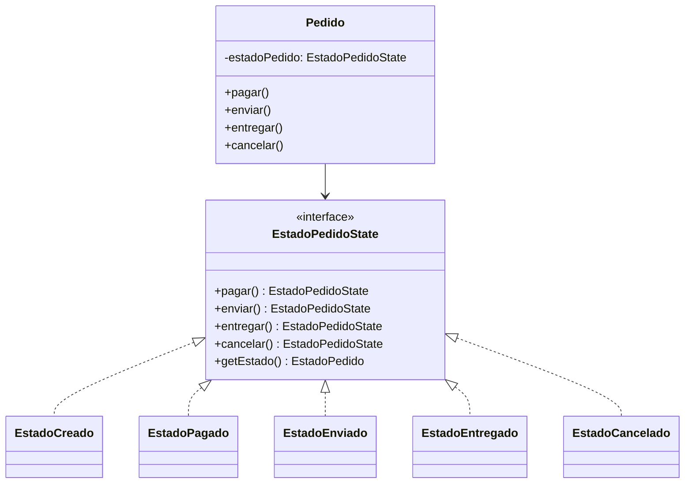

# State

## Problema

En un e-commerce, un pedido no puede realizar cualquier acción en cualquier momento.

Por ejemplo:

- Un pedido **CREADO** puede pagarse o cancelarse.
- Un pedido **PAGADO** puede enviarse.
- Un pedido **ENVIADO** puede entregarse.
- Un pedido **ENTREGADO** ya no puede modificarse.

Sin aplicar el patrón State, estas reglas suelen implementarse mediante cadenas de `if`, `else` o `switch`, haciendo que la lógica crezca a medida que aparecen nuevos estados y transiciones.

```java
public void enviar() {
    if (estado == EstadoPedido.PAGADO) {
        estado = EstadoPedido.ENVIADO;
    } else {
        throw new IllegalStateException(
                "Solo se puede enviar un pedido pagado"
        );
    }
}
```

A medida que aparecen nuevos estados o nuevas reglas de negocio, estos bloques condicionales crecen y la clase resulta más difícil de mantener.

---

## Solución

El patrón **State** encapsula el comportamiento asociado a cada estado dentro de una clase independiente.

En lugar de preguntar constantemente en qué estado se encuentra el objeto, cada estado sabe qué operaciones permite realizar y cuál será el siguiente estado.

En este ejemplo, todos los estados implementan la interfaz `EstadoPedidoState`.

```java
public interface EstadoPedidoState {

    EstadoPedidoState pagar();

    EstadoPedidoState enviar();

    EstadoPedidoState entregar();

    EstadoPedidoState cancelar();

    EstadoPedido getEstado();
}
```

Cada implementación representa un estado distinto del pedido:

- `EstadoCreado`
- `EstadoPagado`
- `EstadoEnviado`
- `EstadoEntregado`
- `EstadoCancelado`

La clase `Pedido` mantiene una referencia al estado actual y delega en él cada operación.

De esta manera, es posible modificar o incorporar nuevos estados sin llenar la clase de condiciones.

---

## Antes y después de aplicar State

### Sin State

Sin aplicar el patrón, `Pedido` debería consultar constantemente en qué estado se encuentra.

```java
public void enviar() {

    if (estado == EstadoPedido.PAGADO) {
        estado = EstadoPedido.ENVIADO;
    } else {
        throw new IllegalStateException("Solo se puede enviar un pedido pagado");
    }
}
```

Cada nuevo estado o nueva transición obliga a agregar nuevas condiciones.

### Con State

Con State, `Pedido` delega la operación al objeto que representa el estado actual.

```java
public void enviar() {
    cambiarEstado(estadoPedido.enviar());
}
```

Cada estado decide qué transición realizar y cuáles operaciones son válidas.

---

## Ejemplo en este proyecto

En este proyecto, el `Pedido` se construye previamente mediante el patrón **Builder**.

El pedido comienza en estado `CREADO`.

```java
Pedido pedido = new PedidoBuilder()
        .conId(1L)
        .conCliente(cliente)
        .agregarProducto(producto)
        .conMetodoDePago(MetodoDePago.MERCADO_PAGO)
        .conDireccionEnvio("Av. Rivadavia 1234")
        .construir();
```

Luego se realizan distintas transiciones.

```java
pedido.pagar();
pedido.enviar();
pedido.entregar();
```

Internamente, cada operación delega la responsabilidad al estado actual.

```java
public void pagar() {
    cambiarEstado(estadoPedido.pagar());
}
```

La salida del ejemplo es:

```text
Estado inicial: CREADO

Luego de pagar: PAGADO

Luego de enviar: ENVIADO

Luego de entregar: ENTREGADO
```

Cada estado decide cuál es el siguiente estado válido y qué operaciones no están permitidas.

---

## ¿Por qué separar cada estado en una clase?

Cada clase representa únicamente el comportamiento correspondiente a un estado específico.

Por ejemplo, `EstadoPagado` conoce qué operaciones son válidas.

```java
@Override
public EstadoPedidoState enviar() {
    return new EstadoEnviado();
}
```

Mientras que una operación no permitida para ese estado simplemente lanza una excepción.

```java
@Override
public EstadoPedidoState pagar() {
    throw new IllegalStateException("El pedido ya se encuentra pagado");
}
```

De esta manera, las reglas quedan distribuidas entre los distintos estados en lugar de concentrarse en una única clase.

---

## Flujo del ejemplo

```text
Pedido
   │
   ▼
EstadoCreado
   │ pagar()
   ▼
EstadoPagado
   │ enviar()
   ▼
EstadoEnviado
   │ entregar()
   ▼
EstadoEntregado
```

Cada estado conoce cuál es la siguiente transición permitida.

---

## Diferencia entre State y Strategy

Aunque ambos patrones utilizan composición y delegación, resuelven problemas diferentes.

**Strategy** responde:

> ¿Qué algoritmo o comportamiento quiero utilizar?

Por ejemplo:

- pagar con Mercado Pago;
- pagar con tarjeta;
- pagar por transferencia.

La estrategia puede cambiarse libremente.

**State** responde:

> ¿Cómo debe comportarse el objeto según su estado actual?

Por ejemplo:

- un pedido creado puede pagarse;
- un pedido pagado puede enviarse;
- un pedido enviado puede entregarse.

En State, el comportamiento depende del estado interno del objeto.

En Strategy, el comportamiento depende de la estrategia seleccionada.

---

## Diagrama UML



En este diagrama se puede ver que `Pedido` mantiene una referencia al estado actual.

Cada implementación de `EstadoPedidoState` define cómo responder ante cada operación y cuál será la siguiente transición.

---

## Código principal

```java
System.out.println("Estado inicial: " + pedido.getEstadoPedido());

pedido.pagar();
System.out.println("Luego de pagar: " + pedido.getEstadoPedido());

pedido.enviar();
System.out.println("Luego de enviar: " + pedido.getEstadoPedido());

pedido.entregar();
System.out.println("Luego de entregar: " + pedido.getEstadoPedido());
```

Cada transición modifica internamente el estado del pedido y cambia el comportamiento disponible para las siguientes operaciones.

---

## Estructura del ejemplo

```text
state/
│
├── EstadoPedidoState.java
├── EstadoCreado.java
├── EstadoPagado.java
├── EstadoEnviado.java
├── EstadoEntregado.java
├── EstadoCancelado.java
└── StateDemo.java
```

Además, este ejemplo reutiliza:

```text
ecommerce/
└── Pedido.java

creacionales/
└── builder/
    └── PedidoBuilder.java
```

---

## Código fuente

El código completo del ejemplo se encuentra en:

[Ver código de State](../../src/main/java/com/bren/patrones/comportamiento/state)

---

## Cuándo usar State

Conviene utilizar State cuando:

- Un objeto cambia su comportamiento según su estado.
- Existen muchas transiciones entre estados.
- Se desea eliminar cadenas de `if` o `switch`.
- Cada estado posee reglas propias.

---

## Cuándo no usarlo

No conviene aplicar State cuando:

- El objeto posee muy pocos estados.
- El comportamiento prácticamente no cambia.
- Las reglas pueden resolverse con una condición simple.
- Incorporar múltiples clases agrega más complejidad que beneficio.

---

## Resumen

State es un patrón de comportamiento que permite encapsular el comportamiento asociado a cada estado dentro de clases independientes.

En este ejemplo, `Pedido` delega cada operación al objeto que representa su estado actual.

`EstadoCreado`, `EstadoPagado`, `EstadoEnviado`, `EstadoEntregado` y `EstadoCancelado` determinan qué operaciones son válidas y cuál será la siguiente transición.

De esta manera, es posible agregar nuevos estados o modificar las reglas de transición sin concentrar toda la lógica en la clase `Pedido`.