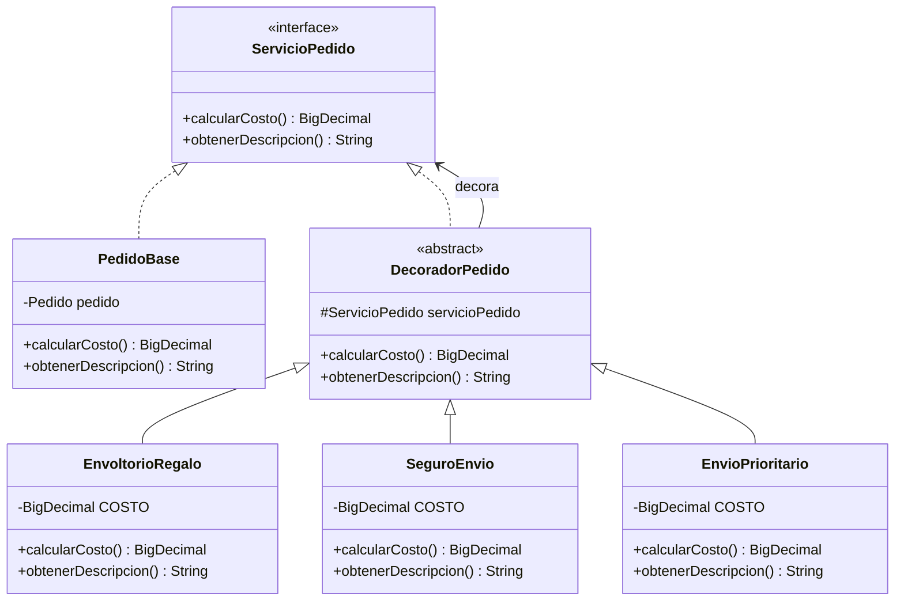

# Decorator

## Problema

En un e-commerce, un pedido puede incorporar distintos servicios opcionales, por ejemplo:

- Envoltorio para regalo.
- Seguro de envío.
- Envío prioritario.

Una primera solución podría ser crear una subclase para cada tipo de pedido:

```java
PedidoConRegalo
PedidoConSeguro
PedidoConEnvioPrioritario
```

Sin embargo, el problema aparece cuando estos servicios pueden combinarse:

```java
PedidoConRegaloYSeguro
PedidoConRegaloYEnvioPrioritario
PedidoConSeguroYEnvioPrioritario
PedidoConRegaloYSeguroYEnvioPrioritario
```

A medida que aparecen nuevos servicios, la cantidad de combinaciones y subclases crece rápidamente.

Esto genera una **explosión de clases**, haciendo que el código sea más difícil de mantener y extender.

---

## Solución

El patrón **Decorator** permite agregar responsabilidades a un objeto de forma dinámica, sin modificar su clase original y sin crear una subclase para cada posible combinación.

En lugar de representar cada combinación mediante una clase diferente, cada funcionalidad adicional se encapsula en un decorador.

Todos los decoradores implementan la misma interfaz que el objeto que decoran y contienen internamente otro objeto de esa misma interfaz.

Cada decorador:

- Delega el comportamiento existente.
- Agrega su propia responsabilidad.
- Puede envolver al objeto base o a otro decorador.

De esta manera, los servicios pueden combinarse libremente.

---

## Antes y después de aplicar Decorator

### Sin Decorator

Sin aplicar el patrón, una solución basada en herencia podría terminar generando una clase para cada combinación posible.

```java
class PedidoConRegalo extends Pedido { }

class PedidoConSeguro extends Pedido { }

class PedidoConRegaloYSeguro extends Pedido { }

class PedidoConRegaloYSeguroYEnvioPrioritario extends Pedido { }
```

Cada nuevo servicio aumenta la cantidad de combinaciones y, por lo tanto, la cantidad de clases necesarias.

### Con Decorator

Con Decorator, cada servicio adicional se representa mediante un objeto independiente.

```java
ServicioPedido servicioPedido =
        new EnvioPrioritario(
            new SeguroEnvio(
                new EnvoltorioRegalo(
                    new PedidoBase(pedido)
                )
            )
        );
```

Los servicios pueden agregarse y combinarse dinámicamente sin crear una clase específica para cada combinación.

---

## Ejemplo en este proyecto

En este proyecto, el `Pedido` se construye previamente mediante el patrón **Builder**.

```java
Pedido pedido = new PedidoBuilder()
        .conId(1L)
        .conCliente(cliente)
        .agregarProducto(producto)
        .conMetodoDePago(MetodoDePago.MERCADO_PAGO)
        .conDireccionEnvio("Av. Rivadavia 1234")
        .construir();
```

Para aplicar Decorator sin modificar la clase `Pedido`, se creó la interfaz `ServicioPedido`.

```java
public interface ServicioPedido {

    BigDecimal calcularCosto();

    String obtenerDescripcion();
}
```

`PedidoBase` implementa esta interfaz y envuelve al `Pedido` existente.

```java
public class PedidoBase implements ServicioPedido {

    private final Pedido pedido;

    @Override
    public BigDecimal calcularCosto() {
        return pedido.calcularTotal();
    }

    @Override
    public String obtenerDescripcion() {
        return "Pedido " + pedido.getId();
    }
}
```

De esta manera, el pedido original continúa manteniendo sus responsabilidades y los servicios adicionales se incorporan desde afuera.

---

## ¿Cómo funciona un decorador?

### Decorador base

Todos los decoradores heredan de `DecoradorPedido`.

```java
public abstract class DecoradorPedido implements ServicioPedido {

    protected final ServicioPedido servicioPedido;

    protected DecoradorPedido(ServicioPedido servicioPedido) {
        this.servicioPedido = servicioPedido;
    }

    @Override
    public BigDecimal calcularCosto() {
        return servicioPedido.calcularCosto();
    }

    @Override
    public String obtenerDescripcion() {
        return servicioPedido.obtenerDescripcion();
    }
}
```

La característica fundamental es que `DecoradorPedido` implementa `ServicioPedido` y, al mismo tiempo, contiene otro `ServicioPedido`.

Esto permite envolver tanto un `PedidoBase` como otro decorador.

### Decoradores concretos

En este ejemplo se implementaron tres servicios adicionales.

#### Envoltorio para regalo

Agrega un costo de `$2000`.

```java
@Override
public BigDecimal calcularCosto() {
    return super.calcularCosto().add(COSTO);
}
```

#### Seguro de envío

Agrega un costo de `$5000`.

```java
@Override
public BigDecimal calcularCosto() {
    return super.calcularCosto().add(COSTO);
}
```

#### Envío prioritario

Agrega un costo de `$8000`.

```java
@Override
public BigDecimal calcularCosto() {
    return super.calcularCosto().add(COSTO);
}
```

Cada decorador obtiene primero el costo del objeto que está envolviendo y luego agrega su propio costo.

---

## Flujo del ejemplo

Partimos del `Pedido` existente y lo envolvemos con `PedidoBase`.

```java
ServicioPedido servicioPedido = new PedidoBase(pedido);
```

Luego agregamos los servicios que necesitamos.

```java
servicioPedido = new EnvoltorioRegalo(servicioPedido);
servicioPedido = new SeguroEnvio(servicioPedido);
servicioPedido = new EnvioPrioritario(servicioPedido);
```

El objeto resultante queda compuesto de la siguiente manera:

```text
EnvioPrioritario
    ↓
SeguroEnvio
    ↓
EnvoltorioRegalo
    ↓
PedidoBase
    ↓
Pedido
```

Cuando se solicita el costo, cada decorador delega la operación al objeto que contiene y luego agrega su propio valor.

Si el pedido original tiene un costo de `$1500000`, el resultado será:

```text
Pedido base: $1500000
+ Envoltorio para regalo: $2000
+ Seguro de envío: $5000
+ Envío prioritario: $8000

Total: $1515000
```

---

## Diferencia entre Decorator y Adapter

Aunque ambos son patrones estructurales y utilizan composición, resuelven problemas diferentes.

**Adapter** responde:

> ¿Cómo puedo utilizar un objeto cuya interfaz no es compatible con la que necesita mi sistema?

En este proyecto, `MercadoPagoAdapter` permite utilizar la API de Mercado Pago mediante la interfaz esperada por el e-commerce.

```text
Interfaz del e-commerce
        ↓
      Adapter
        ↓
API de Mercado Pago
```

Adapter hace compatibles interfaces diferentes.

**Decorator** responde:

> ¿Cómo puedo agregar responsabilidades a un objeto sin modificar su clase?

En este ejemplo, distintos servicios se agregan alrededor de un `PedidoBase`.

```text
EnvioPrioritario
        ↓
SeguroEnvio
        ↓
EnvoltorioRegalo
        ↓
PedidoBase
```

Decorator mantiene la misma interfaz y agrega comportamiento alrededor del objeto.

En resumen:

> **Adapter hace compatibles interfaces diferentes. Decorator agrega responsabilidades manteniendo la misma interfaz.**

---

## Diagrama UML



En este diagrama se puede ver que tanto `PedidoBase` como `DecoradorPedido` implementan `ServicioPedido`.

A su vez, cada decorador concreto hereda de `DecoradorPedido`, que mantiene una referencia a otro `ServicioPedido`. Esto permite encadenar diferentes decoradores alrededor del pedido base.

---

## Código principal

```java
ServicioPedido servicioPedido = new PedidoBase(pedido);

System.out.println("Pedido base: " + servicioPedido.obtenerDescripcion());
System.out.println("Costo base: $" + servicioPedido.calcularCosto());

servicioPedido = new EnvoltorioRegalo(servicioPedido);
servicioPedido = new SeguroEnvio(servicioPedido);
servicioPedido = new EnvioPrioritario(servicioPedido);

System.out.println();
System.out.println("Descripcion final: " + servicioPedido.obtenerDescripcion());
System.out.println("Costo final: $" + servicioPedido.calcularCosto());
```

La salida del ejemplo es:

```text
Pedido base: Pedido 1
Costo base: $1500000

Descripcion final: Pedido 1 + envoltorio para regalo + seguro de envio + envio prioritario
Costo final: $1515000
```

Cada decorador agrega su responsabilidad sin modificar el `Pedido` original.

---

## Estructura del ejemplo

```text
decorator/
│
├── ServicioPedido.java
├── PedidoBase.java
├── DecoradorPedido.java
├── EnvoltorioRegalo.java
├── SeguroEnvio.java
├── EnvioPrioritario.java
└── DecoratorDemo.java
```

Además, este ejemplo reutiliza:

```text
ecommerce/
└── Pedido.java

creacionales/
└── builder/
    └── PedidoBuilder.java
```

---

## Código fuente

El código completo del ejemplo se encuentra en:

[Ver código de Decorator](../../src/main/java/com/bren/patrones/estructurales/decorator)

---

## Cuándo usar Decorator

Conviene utilizar Decorator cuando:

- Se necesitan agregar responsabilidades opcionales a un objeto.
- Las funcionalidades pueden combinarse de diferentes maneras.
- Se quiere evitar crear una subclase por cada combinación.
- Se necesita agregar comportamiento sin modificar la clase original.
- Las responsabilidades deben poder agregarse dinámicamente.

---

## Cuándo no usarlo

No conviene aplicar Decorator cuando:

- Existen muy pocas combinaciones y son fijas.
- Las responsabilidades adicionales no necesitan combinarse.
- Una solución más simple puede resolver el problema.
- El uso de múltiples decoradores agrega más complejidad que beneficio.

Una cadena con demasiados decoradores también puede resultar más difícil de seguir y depurar.

---

## Resumen

Decorator es un patrón estructural que permite agregar responsabilidades a un objeto de forma dinámica mediante composición.

En este ejemplo, `PedidoBase` representa al pedido original, mientras que `EnvoltorioRegalo`, `SeguroEnvio` y `EnvioPrioritario` agregan servicios adicionales.

Cada decorador mantiene la misma interfaz y puede envolver tanto al componente base como a otro decorador.

De esta manera, es posible combinar diferentes funcionalidades sin modificar `Pedido` y sin crear una subclase para cada combinación posible.