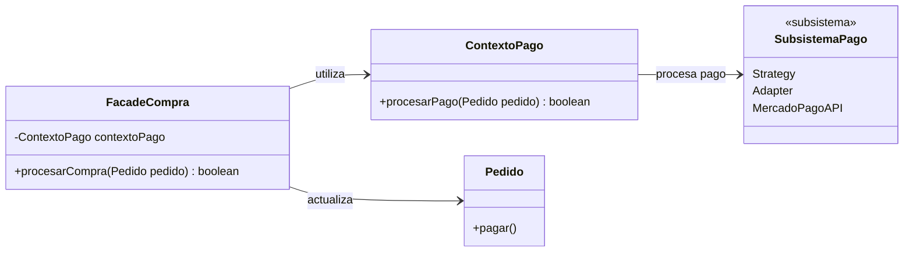

# Facade

## Problema

En una aplicación, una operación puede requerir la interacción de múltiples clases o subsistemas.

En este e-commerce, procesar una compra requiere coordinar distintos componentes del sistema.

`FacadeCompra` interactúa directamente con `ContextoPago`, para procesar el pago, y con `Pedido`, para actualizar su estado cuando el pago es exitoso.

A partir de estas operaciones también intervienen otros componentes y patrones ya implementados en el proyecto, como Strategy, Adapter, State y Observer.

Sin una abstracción adicional, el código que inicia una compra tendría que encargarse de coordinar directamente las operaciones necesarias para completar este proceso.

Por ejemplo:

```java
boolean pagoExitoso = contextoPago.procesarPago(pedido);

if (pagoExitoso) {
    pedido.pagar();
}
```

A medida que el proceso incorpora nuevas operaciones, el código cliente puede terminar dependiendo de cada vez más componentes del sistema.

---

## Solución

El patrón **Facade** proporciona una interfaz simplificada para acceder a un conjunto de clases o subsistemas.

En este proyecto se implementó `FacadeCompra`, que ofrece una única operación para procesar una compra:

```java
facadeCompra.procesarCompra(pedido);
```

La fachada se encarga de coordinar internamente las operaciones necesarias:

1. Procesar el pago utilizando `ContextoPago`.
2. Verificar si el pago fue exitoso.
3. Cambiar el estado del pedido mediante `pedido.pagar()`.

De esta manera, el código que utiliza la fachada no necesita conocer cómo coordinar cada uno de estos componentes.

---

## Antes y después de aplicar Facade

### Antes

Sin Facade, el código que inicia una compra debe coordinar directamente los componentes involucrados:

```java
boolean pagoExitoso = contextoPago.procesarPago(pedido);

if (pagoExitoso) {
    pedido.pagar();
}
```

El código cliente necesita saber:

- Cómo procesar el pago.
- Qué componente utilizar.
- Qué hacer cuando el pago es exitoso.
- Cuándo cambiar el estado del pedido.

### Después

Con Facade:

```java
boolean compraExitosa = facadeCompra.procesarCompra(pedido);
```

Ahora la coordinación queda encapsulada dentro de `FacadeCompra`.

El código cliente solamente necesita conocer la operación de alto nivel que quiere realizar.

---

## Ejemplo en este proyecto

La fachada recibe un `ContextoPago`:

```java
public class FacadeCompra {

    private final ContextoPago contextoPago;

    public FacadeCompra(ContextoPago contextoPago) {
        if (contextoPago == null) {
            throw new IllegalArgumentException("El contexto de pago no puede ser nulo");
        }

        this.contextoPago = contextoPago;
    }
}
```

El método `procesarCompra()` coordina el proceso:

```java
public boolean procesarCompra(Pedido pedido) {
    if (pedido == null) {
        throw new IllegalArgumentException("El pedido no puede ser nulo");
    }

    boolean pagoExitoso = contextoPago.procesarPago(pedido);

    if (pagoExitoso) {
        pedido.pagar();
    }

    return pagoExitoso;
}
```

La fachada no implementa la lógica de pago ni las transiciones de estado.

Su responsabilidad es **coordinar los componentes que ya realizan esas tareas**.

---

## ¿Cómo funciona Facade?

El flujo implementado es:

```text
FacadeDemo
    │
    ▼
FacadeCompra
    │
    ├── ContextoPago
    │       │
    │       ▼
    │   PagoConMercadoPago
    │       │
    │       ▼
    │   MercadoPagoAdapter
    │       │
    │       ▼
    │   MercadoPagoAPI
    │
    └── Pedido.pagar()
            │
            ▼
           State
            │
            ▼
       CREADO → PAGADO
```

`FacadeCompra` funciona como punto de entrada al proceso.

Cuando se ejecuta:

```java
facadeCompra.procesarCompra(pedido);
```

la fachada primero delega el procesamiento del pago a `ContextoPago`.

Si el pago es exitoso, ejecuta:

```java
pedido.pagar();
```

A partir de ese momento, `Pedido` continúa utilizando la lógica ya implementada mediante State y, si existen observadores registrados, Observer puede reaccionar al cambio de estado.

Facade no reemplaza estos patrones, sino que simplifica la forma de acceder al proceso que los utiliza.

---

## Colaboración con otros patrones

Este ejemplo permite reutilizar varios patrones implementados anteriormente en el proyecto.

### Strategy

`ContextoPago` delega el procesamiento del pago a la estrategia configurada.

En este caso:

```text
ContextoPago
      ↓
PagoConMercadoPago
```

### Adapter

`PagoConMercadoPago` utiliza `MercadoPagoAdapter` para conectar el sistema con `MercadoPagoAPI`.

```text
PagoConMercadoPago
        ↓
MercadoPagoAdapter
        ↓
MercadoPagoAPI
```

### State

Cuando el pago es exitoso, Facade ejecuta:

```java
pedido.pagar();
```

El pedido delega el comportamiento correspondiente a su estado actual y pasa de:

```text
CREADO → PAGADO
```

### Observer

Si el pedido tiene observadores registrados, el cambio de estado puede generar las notificaciones correspondientes mediante el mecanismo Observer ya implementado.

Facade no necesita conocer qué observadores existen ni cómo funcionan.

---

## Diferencia entre Facade y Adapter

Aunque ambos son patrones estructurales, resuelven problemas diferentes.

### Adapter

**Adapter** permite que dos interfaces incompatibles puedan trabajar juntas.

En este proyecto:

```text
ProcesadorPago
      ↑
MercadoPagoAdapter
      ↓
MercadoPagoAPI
```

El sistema espera trabajar con `ProcesadorPago`, mientras que la API externa de Mercado Pago posee una interfaz diferente.

El Adapter traduce entre ambas interfaces.

### Facade

**Facade** proporciona una interfaz más simple para utilizar uno o varios componentes de un subsistema.

En este proyecto:

```text
Código cliente
      ↓
FacadeCompra
      ↓
ContextoPago + Pedido + otros componentes
```

No adapta una interfaz incompatible.

Simplifica la forma en la que el código cliente utiliza y coordina el sistema.

En resumen:

```text
Adapter → hace compatibles interfaces diferentes.

Facade  → simplifica el acceso a un subsistema.
```

---

## Diagrama UML



El diagrama muestra cómo `FacadeCompra` proporciona un punto de entrada simplificado al proceso de compra.

La fachada interactúa directamente con `ContextoPago` para procesar el pago y con `Pedido` para actualizar su estado. `SubsistemaPago` representa de forma simplificada los componentes internos que participan en el procesamiento del pago, como Strategy, Adapter y `MercadoPagoAPI`; no corresponde a una clase concreta de la implementación.

El objetivo de Facade no es reemplazar estos componentes, sino simplificar la forma en la que el código cliente accede al proceso.

---

## Código principal

La utilización de la fachada queda reducida a:

```java
FacadeCompra facadeCompra = new FacadeCompra(contextoPago);

boolean compraExitosa = facadeCompra.procesarCompra(pedido);
```

Aunque desde el exterior se utiliza una única operación, internamente continúan colaborando los distintos componentes del sistema.

---

## Flujo del ejemplo

El pedido comienza en estado:

```text
CREADO
```

Se ejecuta:

```java
facadeCompra.procesarCompra(pedido);
```

La estrategia seleccionada es Mercado Pago y el pago se procesa mediante el Adapter existente.

La ejecución produce:

```text
Estado inicial: CREADO
Estrategia seleccionada: Mercado Pago
Adaptando la informacion del pedido para Mercado Pago
--- Mercado Pago ---
Procesando pago mediante Mercado Pago
Referencia: PED-1
Importe: $1500000
--------------------
Compra exitosa: true
Estado final: PAGADO
```

Como el pago fue exitoso, `FacadeCompra` ejecuta `pedido.pagar()` y el pedido pasa de `CREADO` a `PAGADO`.

---

## Estructura del ejemplo

```text
patrones-estructurales/
└── facade/
    └── README.md

src/main/java/com/bren/patrones/estructurales/
└── facade/
    ├── FacadeCompra.java
    └── FacadeDemo.java
```

### `FacadeCompra`

Representa la fachada.

Expone una operación simple para procesar una compra y coordina los componentes necesarios.

### `FacadeDemo`

Construye los objetos necesarios para ejecutar el ejemplo y demuestra el uso de `FacadeCompra`.

No forma parte del patrón en sí, sino que permite visualizar su funcionamiento dentro del proyecto.

---

## Código fuente

El código completo del ejemplo se encuentra en:

[Ver código de Facade](../../src/main/java/com/bren/patrones/estructurales/facade)

---

## Cuándo usar Facade

Facade puede ser útil cuando:

- Un subsistema posee varias clases que deben utilizarse de manera coordinada.
- Se quiere ofrecer una interfaz más simple para una operación compleja.
- Se busca reducir el acoplamiento entre el código cliente y los componentes internos.
- Se quiere proporcionar un punto de entrada de alto nivel a determinadas funcionalidades.
- Se necesita ocultar la coordinación entre distintos componentes sin modificar su funcionamiento.

---

## Cuándo no usarlo

No conviene utilizar Facade cuando:

- El subsistema ya posee una interfaz suficientemente simple.
- La fachada solamente agrega una capa adicional sin simplificar realmente el uso.
- El código cliente necesita acceder directamente a funcionalidades específicas de los componentes internos.
- La fachada empieza a concentrar lógica de negocio que debería pertenecer a otras clases.

Facade debe **coordinar responsabilidades**, no convertirse en una clase que implemente toda la lógica del sistema.

---

## Resumen

Facade permite ofrecer una interfaz simplificada para utilizar un conjunto de clases o subsistemas.

En este proyecto, `FacadeCompra` encapsula la coordinación necesaria para procesar una compra:

```java
facadeCompra.procesarCompra(pedido);
```

Internamente reutiliza componentes y patrones ya existentes, como Strategy, Adapter, State y Observer, sin reemplazarlos ni modificar sus responsabilidades.

De esta manera, el código que inicia una compra puede trabajar con una operación de alto nivel sin necesidad de conocer cómo se coordinan internamente todos los componentes involucrados.